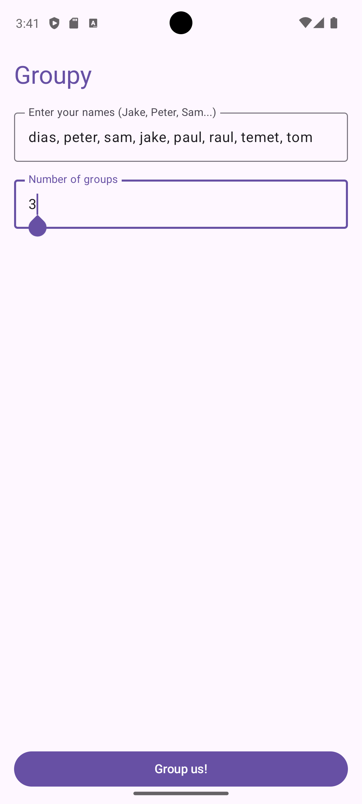
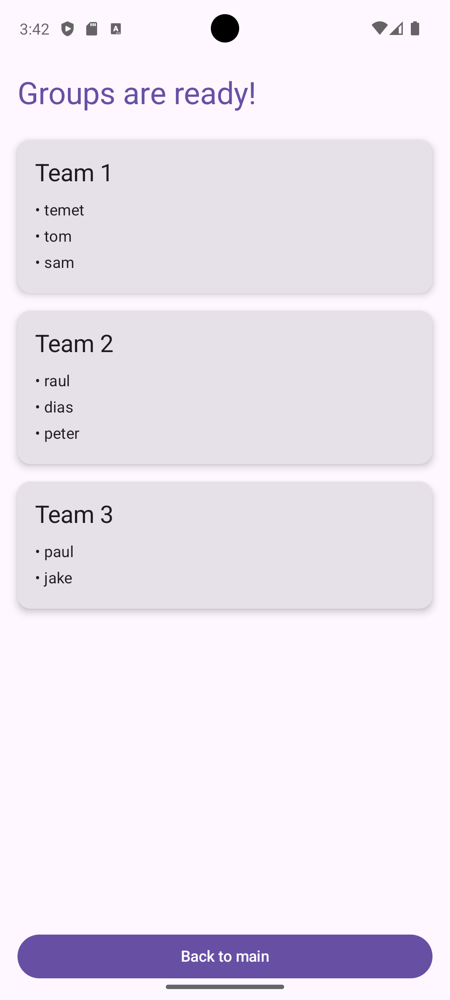

# Groupy — Team Generator App

An Android application built with **Kotlin** and **Jetpack Compose** that randomly splits a list of members into balanced teams.

---

## Features & Architecture

* **MVVM Architecture:** Uses `TeamViewModel` to handle logic and preserve data across configuration changes.
* **Jetpack Compose & Material 3:** Modern UI with custom components (`AppHeader`, `TeamCard`, `CustomInputField`).
* **State Management:** Utilizes `rememberSaveable` and `ViewModel` for UI state persistence during device rotation.
* **Lazy Layouts:** Renders generated teams dynamically using `LazyColumn`.

---

## Screenshots

* **Input Screen:**
  

* **Results Screen:**
  
---

## How to Run

1. Open the project in **Android Studio** (Ladybug / Iguana or newer).
2. Sync Project with Gradle Files.
3. Run on an Android Emulator or physical device (API 24+).

---

## Technical Notes (State Management)

* **`remember`**: Retains state only during composition (resets on rotation).
* **`rememberSaveable`**: Retains UI state across Activity recreation (e.g., device rotation).
* **`ViewModel`**: Manages complex business logic and retains application state throughout the Activity lifecycle.